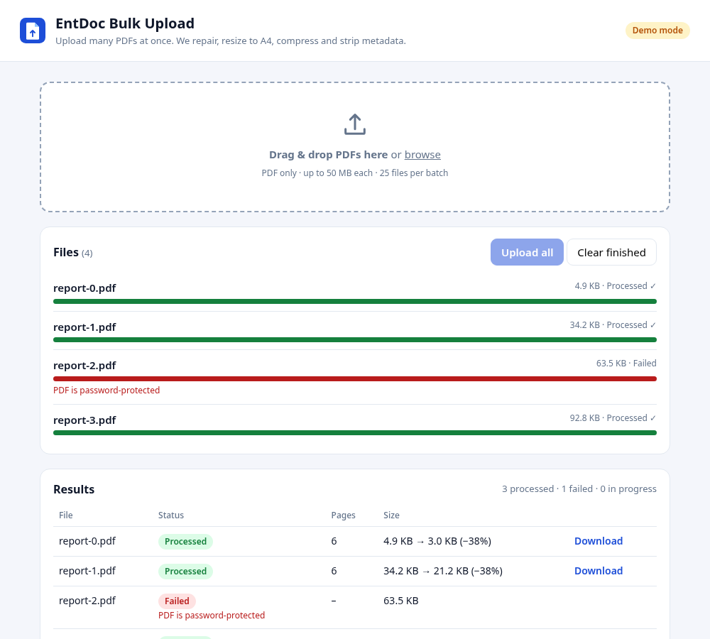
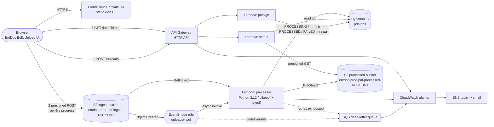
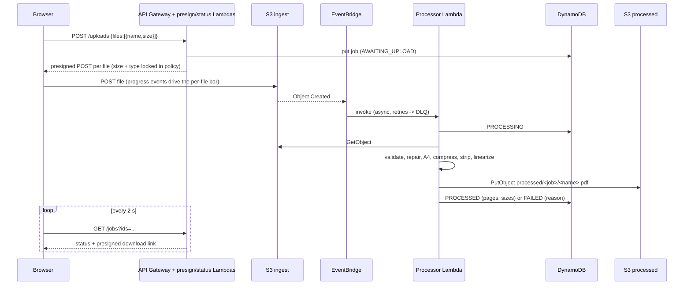

# EntDoc Bulk Upload

Serverless bulk PDF upload and processing on AWS (**ap-south-1 / Mumbai**).
Drag many PDFs into a web page; each one is uploaded straight to a private S3 bucket, then automatically
**validated, repaired, resized to A4, compressed, stripped of metadata and linearized** by a Python Lambda.
Progress and results are visible per file in the UI.



> **Status of this repo:** the code, Terraform and tests are written and verified locally (tests + `terraform validate`).
> **Nothing has been deployed** and no AWS API has been called. You deploy it yourself when ready — see [Deploy](#deploy).
> GitHub Actions is intentionally **disabled** on this repository.

---

## Architecture



### Request lifecycle



### The processing pipeline (`lambdas/processor/pdf_pipeline.py`)

| Step | What happens | Library |
|------|--------------|---------|
| 1. Validate | size limit, `%PDF-` header, opens at all, not password-protected, 1..`max_pages` pages | pikepdf |
| 2. Repair | qpdf rebuilds broken/truncated xref tables; `/OpenAction`, `/AA`, document JavaScript removed | pikepdf |
| 3. Normalize | every page scaled to fit and centred on **A4** (portrait; landscape pages stay landscape), `/Rotate` baked in | pypdf |
| 4. Compress | embedded images recompressed (JPEG quality `image_quality`, default 70), content streams deflated, duplicate objects merged | pypdf + Pillow |
| 5. Strip + linearize | `/Info`, XMP `/Metadata`, `/PieceInfo` removed; written linearized ("fast web view") with object streams | pikepdf |

Bad input (not a PDF, encrypted, too large…) → job `FAILED` with a readable reason and **no retry**.
Unexpected errors → job `RETRYING`, exception re-raised → Lambda async retries (2×) → event lands in the **DLQ** and an alarm fires.
Duplicate S3/EventBridge deliveries are harmless (a `PROCESSED` job is skipped).

Known limitations: links/form fields/bookmarks are not carried over by the A4 re-layout; password-protected PDFs are rejected;
content outside a page's crop box can show in the margin of a scaled page; files are processed fully in memory
(50 MB limit by default).

## Repository layout

```
web/                 Static UI (vanilla JS, no build). Demo mode when config.js has no API URL.
lambdas/api/         presign.py (POST /uploads), status.py (GET /jobs...), common.py
lambdas/processor/   processor.py (event handler), pdf_pipeline.py (pure PDF logic), requirements.txt
terraform/           All infrastructure (validated, never applied by this repo's tooling)
tests/               pytest + moto (S3, DynamoDB) and real PDFs generated with reportlab
scripts/             build_lambdas.sh - builds arm64 / py3.12 Lambda packages locally
.github/workflows/   ci.yml (tests + terraform validate) - Actions is DISABLED on this repo
```

## Resources created by Terraform

| Area | Resource | Notes |
|------|----------|-------|
| Storage | `entdoc-prod-pdf-ingest-<account-id>` | private, SSE-S3, TLS-only, CORS for the UI, originals expire after 7 days |
| Storage | `entdoc-prod-pdf-processed-<account-id>` | private, SSE-S3, TLS-only, results expire after 30 days |
| Storage | `entdoc-prod-web-<account-id>` | private bucket behind CloudFront OAC (UI only) |
| API | HTTP API `POST /uploads`, `GET /jobs`, `GET /jobs/{job_id}` | throttled (25 rps / burst 50), JSON access logs, CORS locked to the UI origin |
| Compute | Lambdas `presign`, `status` (256 MB) and `processor` (2 GB, 120 s) | Python 3.12, arm64, explicit log groups (30 d) |
| Events | EventBridge rule on `Object Created` for `uploads/*.pdf` in the ingest bucket | retry 3× / 1 h then DLQ |
| State | DynamoDB `entdoc-prod-pdf-jobs` | on-demand, PITR on, TTL on `expires_at` |
| Failure | SQS `entdoc-prod-pdf-processing-dlq` | 14-day retention, SSE; fed by EventBridge *and* Lambda async failure destination |
| Delivery | CloudFront distribution | default `*.cloudfront.net` certificate, HTTPS only |
| Alerts | 9 CloudWatch alarms → SNS topic (optional email) | errors ×3, throttles ×3, processor p95 duration, DLQ not empty, API 5xx |

### Least-privilege IAM

Each Lambda has its own role and nothing else is shared:

| Role | Allowed |
|------|---------|
| `presign` | `s3:PutObject` on the ingest bucket `uploads/*` (needed so the presigned POST is valid), `dynamodb:PutItem` on the jobs table, write its own log group |
| `status` | `dynamodb:GetItem/BatchGetItem` on the jobs table, `s3:GetObject` on the processed bucket `processed/*` (to sign downloads), own logs |
| `processor` | `s3:GetObject` on the ingest bucket `uploads/*`, `s3:PutObject` on the processed bucket `processed/*`, `dynamodb:UpdateItem`, `sqs:SendMessage` to the DLQ only, own logs |

No wildcard actions, no `s3:ListBucket`, no `Resource: "*"`. Buckets block all public access and deny non-TLS requests.
Presigned POST policies pin the exact key, `Content-Type: application/pdf` and a content-length range, and expire in 15 minutes.

### Security caveat — read before exposing publicly

**The API has no authentication** (it is a demo). Anyone who can reach the URL can upload PDFs to your account (bounded by throttling,
the 50 MB cap and bucket lifecycle rules). Before real use add one of: Cognito/JWT authorizer on the HTTP API (the `aws_apigatewayv2_api` is
already `HTTP`, so an `aws_apigatewayv2_authorizer` is a small change), CloudFront signed cookies / WAF, or put the UI behind your SSO.
Also consider a customer-managed KMS key and virus scanning (e.g. GuardDuty Malware Protection for S3) for sensitive documents.

---

## Run the tests locally (no AWS account needed)

```bash
python3 -m venv .venv && source .venv/bin/activate
make install        # pip install -r requirements-dev.txt
make test           # 35 tests: PDF pipeline, presign, status, processor, end-to-end flow (moto)
make tf-validate    # terraform init -backend=false + validate + fmt -check (no AWS calls)
```

Try the UI without any backend (simulated progress/results): `cd web && python3 -m http.server 8080` → <http://localhost:8080>.

---

## Deploy

> ⚠️ This creates **real, billable** AWS resources. Nothing in this repo has been deployed yet.

**Prerequisites:** AWS credentials for the target account (`aws sts get-caller-identity` should show the right account),
Terraform ≥ 1.5, Python 3.9+ with `pip`, and permissions to create IAM roles, Lambda, S3, API Gateway, CloudFront, DynamoDB, SQS, EventBridge, CloudWatch and SNS.

```bash
git clone https://github.com/shubhamkhedkar/entdoc-bulk-upload.git && cd entdoc-bulk-upload

# 1. Build the Lambda packages (downloads arm64 wheels; no AWS calls)
make build

# 2. (optional) configure
cp terraform/terraform.tfvars.example terraform/terraform.tfvars   # set alert_email etc.

# 3. Review what will be created, then apply
cd terraform
terraform init
terraform plan -out=tfplan        # read it!
terraform apply tfplan

# 4. Open the UI
terraform output web_url
```

If you set `alert_email`, confirm the SNS subscription email, otherwise alarms are silent.

**Smoke test** after deploying:

```bash
API=$(terraform output -raw api_url)
curl -s -X POST "$API/uploads" -H 'content-type: application/json' \
     -d '{"files":[{"name":"sample.pdf","size":12345}]}'      # returns presigned POST + job_id
curl -s "$API/jobs/<job_id>"                                  # AWAITING_UPLOAD until a file arrives
```
…or just drag PDFs into the web UI. Processing logs: `aws logs tail /aws/lambda/entdoc-prod-processor --follow --region ap-south-1`.

**Handling the DLQ:** when `entdoc-prod-dlq-not-empty` fires, inspect messages in `entdoc-prod-pdf-processing-dlq`
(SQS console → *Poll for messages*), fix the cause, then re-upload the affected file. Messages contain the original S3 event, so you can also replay the key manually.

**Updating:** change code → `make build` → `terraform apply` (Lambda hash changes trigger redeploy). UI files are re-uploaded by Terraform automatically.

### Configuration knobs (`terraform/variables.tf`)

`max_file_size_mb`, `max_files_per_request`, `max_pages`, `image_quality` (0 = skip image recompression), `processor_memory_mb`,
`processor_timeout_seconds`, `ingest_retention_days`, `processed_retention_days`, `job_ttl_days`, `log_retention_days`,
`api_throttle_*`, `cors_extra_origins`, `alert_email`, `force_destroy_buckets`.

Account-id is read from your credentials, so bucket names become `entdoc-prod-pdf-ingest-<account-id>` / `entdoc-prod-pdf-processed-<account-id>` automatically.

---

## Teardown

```bash
cd terraform
terraform destroy          # review the list, type "yes"
```

`force_destroy_buckets` defaults to `true`, so `destroy` also deletes any PDFs still in the three buckets. If you set it to `false`
(recommended for real data), empty the buckets first:

```bash
ACCOUNT=$(aws sts get-caller-identity --query Account --output text)
for b in ingest processed; do aws s3 rm "s3://entdoc-prod-pdf-$b-$ACCOUNT" --recursive; done
aws s3 rm "s3://entdoc-prod-web-$ACCOUNT" --recursive
```

Afterwards verify nothing is left: CloudFront distributions are disabled-then-deleted by Terraform and can take a few minutes; CloudWatch log groups
are managed by Terraform and removed too. The Terraform state file (local by default — `terraform/terraform.tfstate`) is not committed; keep it until destroy finishes.
For team use configure an S3 + DynamoDB remote backend first.

---

## Cost notes

Everything is pay-per-use: **idle cost is ≈ $0** (no NAT gateways, no provisioned capacity, no always-on compute).
Figures below are **indicative, not verified against the live ap-south-1 price list** — check the AWS pricing pages and use the AWS Pricing Calculator before relying on them.

| Component | Cost driver | Rough magnitude |
|-----------|-------------|-----------------|
| Lambda `processor` (arm64, 2 GB) | GB-seconds. A typical 1–5 MB PDF takes a few seconds | ≈ $0.0001–$0.001 per PDF |
| S3 | PUT/GET requests + GB-months; originals kept 7 d, results 30 d | cents per thousand files |
| API Gateway (HTTP API) | per million requests; UI polls every 2 s while jobs run | ≈ $1 per million requests |
| DynamoDB on-demand + PITR | a few writes/reads per file | negligible below millions of files |
| EventBridge | S3 → default bus events from AWS services | free |
| CloudFront | data transfer for the tiny UI + downloads | covered by the monthly free tier for demos |
| CloudWatch | log ingestion/storage (30-day retention), 9 alarms | alarms are inside the 10 free; logs are usually the largest "surprise" line |
| SQS DLQ, SNS | only used on failures / alarms | ≈ $0 |

A rough planning figure: **~10,000 PDFs/month ≈ a few US dollars**. Levers if you need it lower:
`image_quality`/`processor_memory_mb` (less memory = slower, same GB-s curve — measure), shorter retention, `PriceClass_100` on CloudFront,
lower `log_retention_days`, turn off DynamoDB PITR. Set an **AWS Budget** alert on the account before the first deploy.

---

## Verified vs. not verified

Verified locally: unit/integration tests with moto (35 tests), `terraform init -backend=false`, `terraform validate`, `terraform fmt -check`,
the Lambda packaging step (arm64 wheels resolve; zipped size ≈ 14 MB), UI behaviour in simulated demo mode in headless Chrome.

**Not verified** (requires a real deployment): terraform `plan`/`apply`; actual IAM permission sufficiency against real AWS;
presigned POST + S3 CORS from a real browser; the EventBridge `wildcard` pattern and S3→EventBridge delivery; the
arm64 pikepdf/Pillow binaries running on the Lambda runtime; processing time/memory on large real-world PDFs; CloudFront OAC serving;
alarm delivery; all costs.

## License

MIT — demo project, no warranty.
